# Sơ Đồ Thực Thể Quan Hệ (ERD) & CSDL Tổng Thể — DineGo Platform

> **Phân hệ:** CSDL Tổng Thể (Sprint 1 — User Story U004)  
> **Hệ quản trị CSDL:** Microsoft SQL Server 2022  
> **ORM Engine:** Prisma ORM v6  
> **Tài liệu liên quan:** [Tài Liệu Từ Điển Dữ Liệu (Data Dictionary)](./DATA_DICTIONARY.md)

---

## 1. Sơ đồ Thực thể Quan hệ (Mermaid ERD)

Dưới đây là sơ đồ quan hệ hoàn chỉnh của 16 thực thể lõi trong cơ sở dữ liệu `dinego_db`:

```mermaid
erDiagram
    users ||--o{ user_roles : "gán vai trò"
    users ||--o{ user_sessions : "quản lý phiên"
    users ||--o{ merchants : "sở hữu"
    users ||--o| carts : "sở hữu giỏ"
    users ||--o{ orders : "đặt hàng"
    users ||--o{ promotion_usages : "áp dụng mã"

    merchants ||--o{ categories : "phân loại món"
    merchants ||--o{ menu_items : "cung cấp món"
    merchants ||--o{ toppings : "cung cấp topping"
    merchants ||--o{ orders : "tiếp nhận đơn"
    merchants ||--o{ promotions : "phát hành voucher"

    categories ||--o{ menu_items : "chứa"

    menu_items ||--o{ menu_item_toppings : "cho phép topping"
    toppings ||--o{ menu_item_toppings : "gắn vào món"

    carts ||--o{ cart_items : "chứa món"
    cart_items ||--o{ cart_item_toppings : "kèm topping"

    orders ||--o{ order_items : "gồm các món"
    orders ||--o| payments : "thanh toán"
    order_items ||--o{ order_item_toppings : "kèm topping"

    promotions ||--o{ promotion_usages : "lịch sử sử dụng"
    orders ||--o{ promotion_usages : "liên kết đơn"

    users {
        string id PK "uuid"
        string email UK "nvarchar(255)"
        string password_hash "nvarchar(255)"
        string full_name "nvarchar(255)"
        string phone_number UK "nvarchar(50)"
        string avatar_url "nvarchar(max)"
        boolean is_email_verified "bit"
        boolean is_active "bit"
        datetime created_at "datetime2"
        datetime updated_at "datetime2"
    }

    user_roles {
        string id PK "uuid"
        string user_id FK "uuid"
        string role "nvarchar(50) - CUSTOMER | MERCHANT | DRIVER | ADMIN"
        datetime created_at "datetime2"
    }

    user_sessions {
        string id PK "uuid"
        string user_id FK "uuid"
        string token_hash "nvarchar(255)"
        boolean is_revoked "bit"
        datetime expires_at "datetime2"
        datetime created_at "datetime2"
    }

    merchants {
        string id PK "uuid"
        string owner_id FK "uuid"
        string name "nvarchar(255)"
        string slug UK "nvarchar(255)"
        string description "nvarchar(max)"
        string address "nvarchar(500)"
        decimal latitude "decimal(10,7)"
        decimal longitude "decimal(10,7)"
        string phone_number "nvarchar(50)"
        string status "nvarchar(50) - PENDING | APPROVED | REJECTED | SUSPENDED"
        string delivery_type "nvarchar(50) - MERCHANT_SELF | DINEGO_SHIPPER | BOTH"
        boolean is_open "bit"
        boolean is_active "bit"
        decimal rating "decimal(3,2)"
    }

    categories {
        string id PK "uuid"
        string merchant_id FK "uuid"
        string name "nvarchar(255)"
        string description "nvarchar(max)"
        int display_order "int"
        boolean is_active "bit"
    }

    menu_items {
        string id PK "uuid"
        string merchant_id FK "uuid"
        string category_id FK "uuid"
        string name "nvarchar(255)"
        string description "nvarchar(max)"
        decimal price "decimal(10,2)"
        string image_url "nvarchar(max)"
        boolean is_available "bit"
        int preparation_time "int"
    }

    toppings {
        string id PK "uuid"
        string merchant_id FK "uuid"
        string name "nvarchar(255)"
        decimal price "decimal(10,2)"
        boolean is_available "bit"
    }

    menu_item_toppings {
        string menu_item_id PK,FK "uuid"
        string topping_id PK,FK "uuid"
    }

    carts {
        string id PK "uuid"
        string user_id UK,FK "uuid"
        datetime created_at "datetime2"
        datetime updated_at "datetime2"
    }

    cart_items {
        string id PK "uuid"
        string cart_id FK "uuid"
        string menu_item_id FK "uuid"
        int quantity "int"
        string note "nvarchar(500)"
    }

    cart_item_toppings {
        string cart_item_id PK,FK "uuid"
        string topping_id PK,FK "uuid"
    }

    promotions {
        string id PK "uuid"
        string merchant_id FK "uuid"
        string code UK "nvarchar(50)"
        string discount_type "nvarchar(50) - PERCENTAGE | FIXED_AMOUNT"
        decimal discount_value "decimal(10,2)"
        decimal min_order_value "decimal(10,2)"
        decimal max_discount "decimal(10,2)"
        int usage_limit "int"
        int used_count "int"
        datetime start_date "datetime2"
        datetime end_date "datetime2"
        boolean is_active "bit"
    }

    promotion_usages {
        string id PK "uuid"
        string promotion_id FK "uuid"
        string user_id FK "uuid"
        string order_id FK "uuid"
        decimal discount_applied "decimal(10,2)"
        datetime created_at "datetime2"
    }

    orders {
        string id PK "uuid"
        string order_code UK "nvarchar(50)"
        string user_id FK "uuid"
        string merchant_id FK "uuid"
        string status "nvarchar(50) - PENDING | CONFIRMED | PREPARING | READY_FOR_PICKUP | COMPLETED | CANCELLED"
        decimal subtotal "decimal(10,2)"
        decimal shipping_fee "decimal(10,2)"
        decimal discount_amount "decimal(10,2)"
        decimal total_amount "decimal(10,2)"
        string payment_method "nvarchar(50) - MOMO | MOMO_QR | MOMO_ATM | COD"
        string payment_status "nvarchar(50) - PENDING | PROCESSING | SUCCESS | FAILED | CANCELLED | REFUNDED"
        string delivery_address "nvarchar(500)"
        string recipient_name "nvarchar(255)"
        string recipient_phone "nvarchar(50)"
        datetime created_at "datetime2"
    }

    order_items {
        string id PK "uuid"
        string order_id FK "uuid"
        string menu_item_id FK "uuid"
        string item_name "nvarchar(255)"
        decimal unit_price "decimal(10,2)"
        int quantity "int"
        decimal subtotal "decimal(10,2)"
        string note "nvarchar(500)"
    }

    order_item_toppings {
        string id PK "uuid"
        string order_item_id FK "uuid"
        string topping_name "nvarchar(255)"
        decimal unit_price "decimal(10,2)"
    }

    payments {
        string id PK "uuid"
        string order_id UK,FK "uuid"
        string payment_method "nvarchar(50)"
        decimal amount "decimal(10,2)"
        string payment_status "nvarchar(50)"
        string transaction_ref "nvarchar(255)"
        string request_id UK "nvarchar(255)"
        string momo_trans_id "nvarchar(255)"
        string pay_url "nvarchar(max)"
        string gateway_payload "nvarchar(max)"
        datetime paid_at "datetime2"
        datetime created_at "datetime2"
    }
```

---

## 2. Giải pháp Phòng chống Lỗi Microsoft SQL Server Error 1785 (Multiple Cascade Paths)

Trong Microsoft SQL Server, một bảng không thể nhận cascade delete hoặc cascade update từ nhiều đường dẫn khoá ngoại trỏ về cùng một bảng cha hoặc các bảng cha có liên hệ bắc cầu (Error 1785).

### Biện pháp kỹ thuật triển khai trong DineGo:
1. **Quan hệ Order ↔ User & Merchant:**
   - `Order.userId` trỏ tới `User` sử dụng `onDelete: NoAction`.
   - `Order.merchantId` trỏ tới `Merchant` sử dụng `onDelete: NoAction`.
   - Điều này ngăn chặn việc xoá tài khoản `User` kích hoạt xoá dây chuyền gây xung đột với đường xoá của `Merchant`.
2. **Quan hệ MenuItem ↔ Merchant & Category:**
   - `MenuItem.merchantId` và `MenuItem.categoryId` sử dụng `onDelete: NoAction`.
3. **Quan hệ PromotionUsage ↔ Promotion, User & Order:**
   - Tất cả các khoá ngoại trong `PromotionUsage` được đặt `onDelete: NoAction` để bảo toàn tính lịch sử tài chính kiểm toán kể cả khi đối tượng liên quan thay đổi.

